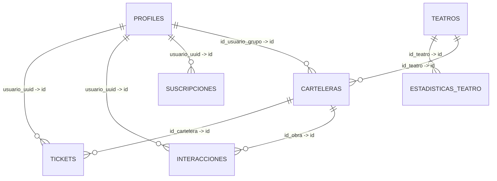

# Base de datos de Teatrando

> **Alcance de este documento:** inventario elaborado a partir de las capturas del esquema de Supabase compartidas el 3 de octubre de 2026 y de la lista de ocho relaciones proporcionada para el proyecto. Refleja lo que se alcanza a observar en esas capturas; no sustituye una consulta directa al esquema actual.
>
> **Importante:** antes de ejecutar migraciones o alterar columnas, contrasta este documento con la base de datos activa. Las capturas permiten identificar nombres y tipos visibles, pero no siempre muestran todos los valores por defecto, restricciones, índices, políticas RLS ni la nulabilidad de cada columna.

## 1. Esquema funcional

Las siguientes nueve tablas aparecen como tablas propias del esquema `public` en las capturas:

| Tabla | Propósito aparente según los nombres de columnas |
|---|---|
| `profiles` | Perfil de usuario, rol, plan y datos de contacto. |
| `teatros` | Información y características de los teatros. |
| `carteleras` | Obras, funciones, fechas, precios y datos de cartelera. |
| `tickets` | Compras, entradas, datos de cliente y estado de uso. |
| `interacciones` | Comentarios, valoraciones y otras interacciones relacionadas con obras/carteleras. |
| `suscripciones` | Planes, estado, fechas y referencias de pago de suscripciones. |
| `estadisticas_teatro` | Métricas agregadas por teatro. |
| `estadisticas_semanales` | Métricas y comparativas semanales. |
| `temas_estacionales` | Configuración visual y fechas de temas estacionales. |

Los propósitos indicados son inferencias razonables a partir de los nombres, no una confirmación del comportamiento del código.

## 2. Diagrama de relaciones conocidas

Este diagrama representa las ocho relaciones explícitas recibidas para el proyecto. No incorpora relaciones que no hayan sido proporcionadas o verificadas.



### 2.1 Relaciones registradas

| Tabla de origen | Columna de origen | Tabla de destino | Columna de destino | Tipos visibles en las capturas |
|---|---|---|---|---|
| `tickets` | `id_cartelera` | `carteleras` | `id` | `varchar(50)` → `varchar(50)` |
| `interacciones` | `id_obra` | `carteleras` | `id` | `varchar(50)` → `varchar(50)` |
| `carteleras` | `id_teatro` | `teatros` | `id` | `int4` → `int4` |
| `suscripciones` | `usuario_uuid` | `profiles` | `id` | `uuid` → `uuid` |
| `tickets` | `usuario_uuid` | `profiles` | `id` | `uuid` → `uuid` |
| `interacciones` | `usuario_uuid` | `profiles` | `id` | `uuid` → `uuid` |
| `estadisticas_teatro` | `id_teatro` | `teatros` | `id` | `int4` → `int4` |
| `carteleras` | `id_usuario_grupo` | `profiles` | `id` | `uuid` → `uuid` |

`int4` equivale a `integer` en PostgreSQL. El diagrama expresa las referencias informadas, pero las capturas por sí solas no confirman si todas las columnas son `NOT NULL`, qué acciones referenciales se configuraron (`ON DELETE`/`ON UPDATE`) o si cada relación sigue activa en la base de datos actual.

## 3. Inventario de tablas y columnas

Los tipos se transcriben con la notación observada en las capturas. `PK` identifica la clave primaria visible en la interfaz; no implica que las demás restricciones se hayan comprobado.

### 3.1 `profiles`

| Columna | Tipo | Nota |
|---|---|---|
| `id` | `uuid` | PK |
| `nombre` | `varchar(255)` | |
| `email` | `varchar(255)` | |
| `rol` | `varchar(50)` | |
| `plan_suscripcion` | `varchar(100)` | |
| `avatar_url` | `text` | |
| `proveedor_auth` | `varchar(50)` | |
| `created_at` | `timestamptz` | |
| `updated_at` | `timestamptz` | |
| `apellido` | `text` | |
| `plan` | `text` | |
| `telefono` | `text` | |
| `ciudad` | `text` | |
| `biografia` | `text` | |
| `activo` | `bool` | |

### 3.2 `teatros`

| Columna | Tipo | Nota |
|---|---|---|
| `id` | `int4` | PK |
| `nombre` | `varchar(255)` | |
| `ubicacion` | `text` | |
| `aforo` | `int4` | |
| `descripcion` | `text` | |
| `historia` | `text` | |
| `direccion` | `text` | |
| `ciudad` | `text` | |
| `telefono` | `text` | |
| `email` | `text` | |
| `imagen` | `text` | |
| `servicios` | `jsonb` | |
| `normas` | `jsonb` | |
| `aforo_total` | `int4` | |
| `activo` | `bool` | |
| `created_at` | `timestamptz` | |
| `updated_at` | `timestamptz` | |
| `estado` | `text` | |
| `sitio_web` | `text` | |

### 3.3 `carteleras`

| Columna | Tipo | Nota |
|---|---|---|
| `id` | `varchar(50)` | PK |
| `id_teatro` | `int4` | FK informada a `teatros.id` |
| `obra` | `varchar(255)` | |
| `funcion` | `varchar(255)` | |
| `genero` | `varchar(100)` | |
| `sala` | `varchar(100)` | |
| `director` | `varchar(255)` | |
| `fecha` | `date` | |
| `hora` | `time` | |
| `precio_usd` | `numeric(10,2)` | |
| `sinopsis` | `text` | |
| `reparto` | `text` | |
| `imagen` | `text` | |
| `duracion_min` | `int4` | |
| `edad_minima` | `varchar(50)` | |
| `visible` | `bool` | |
| `calificacion_promedio` | `numeric(3,2)` | |
| `grupo_teatral` | `varchar(255)` | |
| `id_usuario_grupo` | `uuid` | FK informada a `profiles.id` |
| `butacas_disponibles` | `int4` | |
| `aforo_total` | `int4` | |
| `titulo` | `text` | |
| `descripcion` | `text` | |
| `autor` | `text` | |
| `elenco` | `text` | |
| `imagen_url` | `text` | |
| `fecha_inicio` | `date` | |
| `fecha_fin` | `date` | |
| `precio` | `numeric(12,2)` | |
| `teatro_id` | `uuid` | Revisar junto a `id_teatro` |
| `activo` | `bool` | |
| `categoria` | `text` | |
| `duracion` | `text` | |
| `created_at` | `timestamptz` | |
| `updated_at` | `timestamptz` | |

### 3.4 `tickets`

| Columna | Tipo | Nota |
|---|---|---|
| `id` | `int4` | PK |
| `usuario_uuid` | `uuid` | FK informada a `profiles.id` |
| `id_cartelera` | `varchar(50)` | FK informada a `carteleras.id` |
| `cantidad` | `int4` | |
| `total_usd` | `numeric(10,2)` | |
| `codigo_qr` | `text` | |
| `estado` | `varchar(50)` | |
| `fecha_compra` | `timestamp` | Sin zona horaria, según la etiqueta visible |
| `codigo` | `text` | |
| `id_usuario` | `uuid` | Revisar junto a `usuario_uuid` |
| `email_cliente` | `text` | |
| `nombre_cliente` | `text` | |
| `telefono_cliente` | `text` | |
| `precio_unitario` | `numeric(12,2)` | |
| `precio_total` | `numeric(12,2)` | |
| `metodo_pago` | `text` | |
| `referencia_pago` | `text` | |
| `asiento` | `text` | |
| `fecha_funcion` | `date` | |
| `hora_funcion` | `text` | |
| `usado` | `bool` | |
| `created_at` | `timestamptz` | |
| `updated_at` | `timestamptz` | |
| `id_obra` | `text` | No aparece entre las relaciones informadas |

### 3.5 `interacciones`

| Columna | Tipo | Nota |
|---|---|---|
| `id` | `int4` | PK |
| `id_obra` | `varchar(50)` | FK informada a `carteleras.id` |
| `usuario_uuid` | `uuid` | FK informada a `profiles.id` |
| `tipo` | `varchar(50)` | |
| `nombre_autor` | `varchar(255)` | |
| `rol_autor` | `varchar(100)` | |
| `valor` | `text` | |
| `estrellas` | `int4` | |
| `es_destacada` | `bool` | |
| `fecha_registro` | `timestamp` | Sin zona horaria, según la etiqueta visible |
| `id_usuario` | `uuid` | Revisar junto a `usuario_uuid` |
| `id_cartelera` | `uuid` | Revisar: el tipo no coincide con `carteleras.id` (`varchar(50)`) |
| `comentario` | `text` | |
| `calificacion` | `int4` | |
| `contenido` | `text` | |
| `activo` | `bool` | |
| `created_at` | `timestamptz` | |
| `updated_at` | `timestamptz` | |

### 3.6 `suscripciones`

| Columna | Tipo | Nota |
|---|---|---|
| `id` | `int4` | PK |
| `usuario_uuid` | `uuid` | FK informada a `profiles.id` |
| `tipo_plan` | `varchar(100)` | |
| `estado` | `varchar(50)` | |
| `fecha_inicio` | `timestamp` | Sin zona horaria, según la etiqueta visible |
| `fecha_fin` | `timestamp` | Sin zona horaria, según la etiqueta visible |
| `id_usuario` | `uuid` | Revisar junto a `usuario_uuid` |
| `plan` | `text` | |
| `precio` | `numeric(12,2)` | |
| `metodo_pago` | `text` | |
| `referencia_pago` | `text` | |
| `created_at` | `timestamptz` | |
| `updated_at` | `timestamptz` | |

### 3.7 `estadisticas_teatro`

| Columna | Tipo | Nota |
|---|---|---|
| `id` | `int4` | PK |
| `id_teatro` | `int4` | FK informada a `teatros.id` |
| `ventas_totales` | `numeric(12,2)` | |
| `tickets_vendidos` | `int4` | |
| `updated_at` | `timestamp` | Etiqueta visible como `timestamp` |
| `visitas` | `int4` | |
| `obras_publicadas` | `int4` | |
| `entradas_vendidas` | `int4` | |
| `ingresos` | `numeric(12,2)` | |
| `calificacion_promedio` | `numeric(4,2)` | |

### 3.8 `estadisticas_semanales`

| Columna | Tipo | Nota |
|---|---|---|
| `id` | `int4` | PK |
| `semana_numero` | `int4` | |
| `titulo_evento` | `varchar(255)` | |
| `salas_activas` | `int4` | |
| `capacidad_semanal` | `int4` | |
| `entradas_semana` | `int4` | |
| `crecimiento_porcentaje` | `varchar(50)` | |
| `valoracion_critica` | `numeric(3,2)` | |
| `entradas_por_dia` | `jsonb` | |
| `top_salas` | `jsonb` | |
| `generos_comparativa` | `jsonb` | |
| `nota_salas` | `text` | |
| `nota_generos` | `text` | |
| `created_at` | `timestamptz` | |
| `updated_at` | `timestamptz` | |
| `semana_inicio` | `date` | |
| `visitas` | `int4` | |
| `usuarios_nuevos` | `int4` | |
| `entradas_vendidas` | `int4` | |
| `ingresos` | `numeric(12,2)` | |
| `obras_publicadas` | `int4` | |
| `teatros_activos` | `int4` | |
| `datos` | `jsonb` | |

### 3.9 `temas_estacionales`

| Columna | Tipo | Nota |
|---|---|---|
| `id` | `int4` | PK |
| `nombre` | `varchar(255)` | |
| `descripcion` | `text` | |
| `activo` | `bool` | |
| `fecha_inicio` | `date` | |
| `fecha_fin` | `date` | |
| `color_primario` | `varchar(7)` | |
| `color_secundario` | `varchar(7)` | |
| `color_acento` | `varchar(7)` | |
| `color_fondo` | `varchar(7)` | |
| `color_texto` | `varchar(7)` | |
| `color_texto_suave` | `varchar(7)` | |
| `border_radius` | `varchar(20)` | |
| `hero_image_url` | `text` | |
| `hero_image_mobile_url` | `text` | |
| `logo_variant_url` | `text` | |
| `font_familia` | `varchar(100)` | |
| `updated_at` | `timestamp` | Sin zona horaria, según la etiqueta visible |
| `imagen` | `text` | |
| `imagen_fondo` | `text` | |
| `configuracion` | `jsonb` | |
| `created_at` | `timestamptz` | |

## 4. Puntos que deben verificarse

### 4.1 Columnas que parecen representar el mismo concepto

Las capturas muestran varios campos con nombres similares en una misma tabla. No deben eliminarse automáticamente; primero hay que comprobar qué columnas consume el código de la aplicación y si almacenan información diferente.

| Tabla | Campos a revisar | Motivo |
|---|---|---|
| `carteleras` | `id_teatro` (`int4`) y `teatro_id` (`uuid`) | Nombres parecidos, tipos distintos. Solo `id_teatro` aparece en las relaciones proporcionadas. |
| `tickets` | `usuario_uuid` y `id_usuario` (ambos `uuid`) | Posible duplicidad de referencia al usuario. La relación proporcionada usa `usuario_uuid`. |
| `tickets` | `id_cartelera` (`varchar(50)`) e `id_obra` (`text`) | Ambos podrían identificar contenidos relacionados con una cartelera/obra, pero solo `id_cartelera` aparece como FK en la lista recibida. |
| `interacciones` | `usuario_uuid` y `id_usuario` (ambos `uuid`) | Posible duplicidad de referencia al usuario. La relación proporcionada usa `usuario_uuid`. |
| `interacciones` | `id_obra` (`varchar(50)`) e `id_cartelera` (`uuid`) | `id_obra` aparece relacionado con `carteleras.id`; `id_cartelera` tiene otro tipo y no está incluido en la lista de FKs. |
| `suscripciones` | `usuario_uuid` y `id_usuario` (ambos `uuid`) | Posible duplicidad de referencia al usuario. La relación proporcionada usa `usuario_uuid`. |
| `teatros` | `aforo` e `aforo_total` (ambos `int4`) | Confirmar si representan capacidad general y capacidad configurada o si uno es un campo heredado. |
| `carteleras` | `precio_usd` (`numeric(10,2)`) y `precio` (`numeric(12,2)`) | Confirmar diferencias de significado y moneda antes de modificar cálculos. |
| `tickets` | `total_usd` (`numeric(10,2)`) y `precio_total` (`numeric(12,2)`) | Confirmar si son importes equivalentes o si uno representa un total distinto. |

### 4.2 Relaciones no incluidas en la lista

En las ocho relaciones suministradas no aparecen claves foráneas para `estadisticas_semanales` ni `temas_estacionales`. Esto no demuestra que no existan otras restricciones o relaciones; únicamente significa que no están documentadas en el conjunto de datos recibido.

### 4.3 Esquemas administrados por Supabase

El ZIP también contiene capturas de tablas internas de los servicios de Supabase, además de las nueve tablas de negocio anteriores. Entre los nombres visibles figuran tablas de autenticación y sesiones, MFA/WebAuthn, OAuth/SSO, migraciones, almacenamiento (`buckets`, `objects` y tablas de cargas multipartes), vectores y secretos (`secrets`).

Esas tablas internas no se incluyen en el diagrama funcional de Teatrando. No conviene modificarlas manualmente sin una necesidad concreta y sin seguir el procedimiento recomendado por Supabase. Las políticas de acceso y el esquema de autenticación deben revisarse aparte, porque las capturas de columnas no describen por sí solas las políticas RLS ni todos los permisos.

## 5. Consultas de solo lectura para validar el esquema actual

Ejecuta estas consultas desde el SQL Editor de Supabase para comparar la documentación con el esquema activo. Son consultas de lectura; no modifican datos.

### 5.1 Columnas, tipos, nulabilidad y valores por defecto

```sql
SELECT
  table_schema,
  table_name,
  ordinal_position,
  column_name,
  data_type,
  udt_name,
  is_nullable,
  column_default
FROM information_schema.columns
WHERE table_schema = 'public'
ORDER BY table_name, ordinal_position;
```

### 5.2 Claves foráneas reales del esquema `public`

```sql
SELECT
  tc.constraint_name,
  kcu.table_schema,
  kcu.table_name,
  kcu.column_name,
  ccu.table_schema AS foreign_table_schema,
  ccu.table_name AS foreign_table_name,
  ccu.column_name AS foreign_column_name
FROM information_schema.table_constraints AS tc
JOIN information_schema.key_column_usage AS kcu
  ON tc.constraint_name = kcu.constraint_name
 AND tc.constraint_schema = kcu.constraint_schema
JOIN information_schema.constraint_column_usage AS ccu
  ON ccu.constraint_name = tc.constraint_name
 AND ccu.constraint_schema = tc.constraint_schema
WHERE tc.constraint_type = 'FOREIGN KEY'
  AND tc.table_schema = 'public'
ORDER BY kcu.table_name, kcu.column_name;
```

### 5.3 Claves primarias del esquema `public`

```sql
SELECT
  tc.table_name,
  kcu.column_name,
  kcu.ordinal_position,
  tc.constraint_name
FROM information_schema.table_constraints AS tc
JOIN information_schema.key_column_usage AS kcu
  ON tc.constraint_name = kcu.constraint_name
 AND tc.constraint_schema = kcu.constraint_schema
WHERE tc.constraint_type = 'PRIMARY KEY'
  AND tc.table_schema = 'public'
ORDER BY tc.table_name, kcu.ordinal_position;
```

## 6. Mantenimiento de esta documentación

Cuando cambie el esquema de la base de datos:

1. Genera un inventario actualizado de columnas y claves foráneas desde Supabase.
2. Refleja los cambios mediante migraciones SQL versionadas dentro del repositorio.
3. Actualiza este archivo en el mismo cambio que modifica el esquema.
4. No incluyas contraseñas, claves API privadas, tokens ni datos personales reales en la documentación, capturas o datos de prueba.

> Esta documentación no contiene credenciales ni datos de filas. Los nombres y tipos descritos proceden de las capturas proporcionadas; confirma el estado del esquema antes de usarla como especificación definitiva.
